# Pixel Racer NES

[-2ea44f?style=for-the-badge&logo=github)](https://github.com/Trevor792221/PCR-to-Nes-port/releases/latest/download/pxracer.nes)
[-1f6feb?style=for-the-badge&logo=github)](https://github.com/Trevor792221/PCR-to-Nes-port/releases/latest/download/pixel-racer-soundtrack.zip)

Every version is on the [Releases page](https://github.com/Trevor792221/PCR-to-Nes-port/releases).
What changed in each one: [patch notes](CHANGELOG.md).

**Have a battery save from v1.0 to v2.4?** Load it in
[v2.5](https://github.com/Trevor792221/PCR-to-Nes-port/releases/tag/v2.5),
open OPTIONS > PASSWORD and write down the two passwords, then enter them
in the latest version (TITLE > PASSWORD).

An NES demake of the drag-racing and car-building game style made popular by
**Pixel Car Racer** on Android. It's written from scratch in 6502 assembly and
runs on real NES / Famicom hardware or any accurate emulator.

> **Unofficial fan project.** It isn't made by, endorsed by, or affiliated
> with Studio Furukawa or the makers of Pixel Car Racer. No code, graphics,
> sounds, music or text from the original game are used. The game rules and
> features are reimplemented, and every car sprite, background, tune and car
> name in this ROM is original.

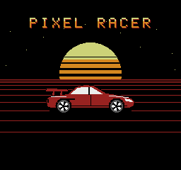 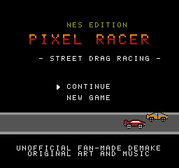 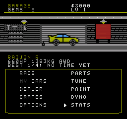
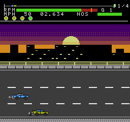 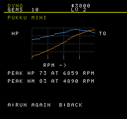
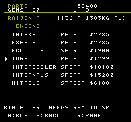 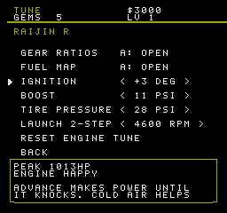 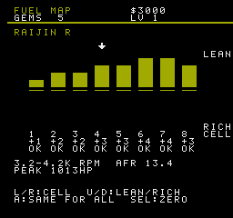 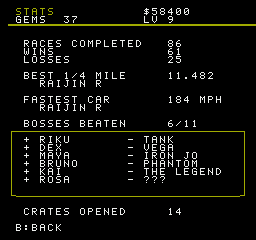
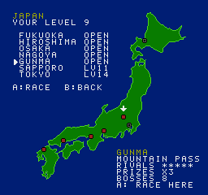

## What carried over from the Android game

| Pixel Car Racer feature | NES version |
|---|---|
| Garage as the game hub, with your car on display | Garage screen: your car shown 2x size in a workshop (ceiling lamps, roll-up door, pegboard, tire stack, tool chest), plus cash, gems and level. The game boots to a splash screen: an original 90s-style sports coupe in front of a neon sunset, with the version number in the bottom right corner |
| Car dealership | 12 original cars from a kei car to a hypercar, each with its own sprite (every car was redesigned in v4.6), power, weight, redline, gear count, drivetrain (FWD/RWD/AWD) and level requirement |
| Owning several cars | 8 garage slots. Switch cars, or sell them for half the car's price plus part value |
| Engine and performance parts | 14 parts at 5 levels each (Stock, Street, Sport, Race, Pro), on two pages (Left/Right to switch). **Engine:** intake, exhaust, ECU tune (also raises the redline and unlocks the fuel map, ignition timing and the 2-step), turbo (with boost lag and spool), intercooler (needs a turbo: more boost and a higher knock limit), injectors (a little power, and fuel for lean maps and overboost), internals, nitrous. **Chassis:** gearbox (faster shifts), tires, suspension, weight reduction, aero kit (less drag for a higher top speed, plus downforce grip), wheelie bars (launch grip: +5 a level on RWD, +3 on FWD and AWD, where they keep the rear from squatting and the weight on the front; you can see them behind the rear wheel in the garage and in races). Each part is priced by how much it actually speeds a car up (measured with the physics model, `tools/part_value.py`): turbo and tires cost the most, injectors the least. Selling a car refunds half of what its upgrades cost |
| Tuning | Garage → TUNE shows the car's peak power and whether the engine knocks or runs lean, live, as you change: **gear ratios** (final drive and each gear, with its top speed; unlocks with any gearbox upgrade), the **fuel map** (after an ECU upgrade; its own screen: 8 cells across the rev range, each from rich to lean; lean makes power until the injectors run out of fuel, rich is safe but slower; A copies a cell to all, SELECT clears the map), **ignition timing** (after an ECU upgrade; -5 to +5 degrees: advance makes power until it knocks, and knock costs a lot; intercoolers and a rich mixture raise the limit, overboost and lean lower it), **boost** (3 psi up to each turbo's maximum: more psi needs fuel and pulls the knock limit down), **tire pressure** (18-40 psi: soft tires grip at launch but drag at speed) the **2-step** launch control (after an ECU upgrade: hold A on the line and the revs wait at the rpm you set) and **nitrous** (with a nitrous kit: a slider from POWER to DURATION; each step left gives a bigger, shorter hit and each step right a gentler one that lasts longer, from 1.5x the boost for 2/3 of the shot to half the boost for twice as long) |
| Engine and drivetrain swaps | Garage → SWAP, paid in gems. **Engine:** any dealer car's engine (from the 1.0 I3 to the hybrid V8) or one of four swap-only crate engines: a **twin-rotor rotary** (255 hp, 9000 rpm, light), a high-rev I4, a flat six and a big-block V8. Each brings its own power, redline, torque curve and weight (the car gains or loses the difference) and costs 10-35 gems; bigger engines unlock at higher levels. The old engine's parts (intake, exhaust, ECU, turbo, internals, nitrous, intercooler, injectors) go back to stock and are bought back at 3/4 of what they cost, and the engine tune is reset. **Drivetrain:** FWD, RWD or AWD for 10 gems. AWD launches hardest but adds weight and loses a little more power through the driveline; FWD is the lightest with the least launch grip. Going back to a car's own engine or drivetrain is free, and each car pays for an engine or drivetrain only once: anything it has had fitted before swaps back in for free. The Zenith X400 can't be swapped. In races a rotary sounds different too |
| Dyno | Live dyno run that plots horsepower and torque (lb-ft) curves on one scale, so they cross at 5252 rpm like a real dyno sheet (a key left of the graph, HP in orange and TQ in blue, says which is which), with peak HP and lb-ft and the rpm where each peaks. The peak HP is the same figure shown in the garage and dealer |
| Paint shop | Body, rim and window colours (24 colours each) with a live preview. Painting is free |
| Crates | Standard (5 gems) and Premium (10 gems) crates, paid in gems only. Rewards are cash, gems, free part upgrades or a whole car. Very rarely (1 in 256 standard, 5 in 256 premium) they hold the **Zenith X400**, a crate-only prototype racer that never spins its tires and tops out over 400 mph. Keep a garage slot free, or the roll goes to a normal reward. Once you beat The Legend (the last ladder boss), the dealer also sells it for $600,000 |
| Drag racing with manual shifting | 1/4 mile, 1/2 mile and full-mile drag races (set the distance in race select). Rev on the line, launch on green, shift by hand, fire nitrous. Shift feedback: Perfect, Good, Early or Late |
| Launch / wheelspin | Clutch-dump launch model: too many revs spin the tires (with smoke), too few bog the engine |
| Street racing | Half-mile street race on 3 lanes with traffic. Change lanes to dodge cars; crashing costs you your speed. Hits are pixel perfect: you crash only when your car's pixels touch a traffic vehicle's, wherever you are in a lane change, so a close shave is a close shave. Traffic is a mix of company vans, work pickups with ladder racks, camper vans and removal trucks, all with light blue windows, each with its own speed range (trucks crawl, the vans nip along). Traffic colours change from race to race. Cruising adds yellow taxis, and some of the other traffic is yellow too |
| Race scenery | Every race picks one of three backgrounds at random: **day** (pale sky, clouds, grey city), **sunset** (purple-to-orange sky, low sun, black skyline) or **night** (navy sky, moon, lit windows) |
| Weather | On top of the time of day, every race has weather, picked by region: **clear**, **cloudy** (a low cloud bank over the day, sunset or night sky), **rain** (falling rain over the road and sky, and a dark wet road) or **snow** (drifting snow and white pavements). Rain costs every car in the race some launch grip and snow costs more, so AWD, good tires and wheelie bars matter more. Clear skies are the most common; snow only falls in Gunma and Sapporo, and Sapporo snows more often than not |
| World map | Garage → RACE opens a map of **Japan**: pick the region you race in. Seven regions open as you level up: Fukuoka (level 1), Hiroshima (7), Osaka (12), Nagoya (17), Gunma (21), Sapporo (23) and Tokyo (31). Each level is about where a player gets to by the time their car can beat the bosses of the region before (worked out by `tools/progress.py`), and each region's bosses are a clear step faster than the last. Quick and street rivals in later regions drive better-tuned, faster cars and react quicker, and they pay more: bets and street prizes go from x1 in Fukuoka up to x4 in Tokyo, and wins give +10 XP per region. The results screen says when a race opens a new region. The map plays its own theme, "Road to Tokyo". The coastline is drawn from [Natural Earth](https://www.naturalearthdata.com/) data (public domain) |
| Story / ladder progression | Ladder of 10 street bosses, plus a final "Legend" boss. Every boss comes from a region on the map and can only be raced there, once your level opens it (bosses 1-2 Fukuoka, 3-4 Hiroshima, 5-6 Osaka, 7 Nagoya, 8 Gunma, 9 Sapporo, 10-11 and Eclipse Tokyo); race select says where the next boss is ("BOSS IS IN OSAKA"). A hidden 12th boss, **Eclipse**, appears in race select only while you drive the Zenith X400 in Tokyo. Beating it pays $500,000 and, the first time, 25 gems. The first time you beat any boss you also **win their car**, just as they raced it (model, parts and paint): it joins your garage marked BOSS CAR, its tune, parts and swaps are locked (paint is fine), and it sells for half the car's price, since its parts came free. With a full garage it's sold for you at once. Before every boss race an intro screen shows the boss, their car in its colours on a lit stage with its HP, a short bio and the prize; B backs out. The intro plays its own theme, "Showdown" |
| Quick races with bets | Random rival on Easy, Medium or Hard, betting $300, $1,000 or $2,500 (more in later map regions). Easy rivals drive sloppily and are 12.5% down on power, so a clean race wins. A win is worth 100 XP on Easy, 150 on Medium and 200 on Hard (plus 10 per map region) |
| Free roam | **Cruise**: endless driving on the 3-lane road, no rival and no finish line. Press Left/Right on CRUISE to turn traffic on or off. Nitrous is unlimited: the bottle refills as soon as a shot ends. START pauses, then SELECT returns to the garage |
| Multiplayer | **2 PLAYER** in race select: a head-to-head drag race on one console. Player 2 uses controller 2 with the same buttons (A gas, Right launch/shift up, Left shift down, B nitrous) and drives any car from your garage (Left/Right on the 2 PLAYER row picks it). Distance follows the DISTANCE setting. Either player can foul by launching early. The HUD splits in two: each player has a rev counter, gear, speed and nitrous bar, with the clock in the middle. The camera keeps both cars on screen until the leader is far ahead. No money, XP or stats are at stake. Online play from the Android game isn't possible on an NES |
| Practice / test runs | Solo test run with elapsed time, trap speed, reaction time and 0-60 time. Reaction time counts from the green light, so a perfect launch (Right on the first frame after green) reads 0.000; any earlier is a foul start. The best 1/4-mile time is kept per car |
| XP, levels and premium currency | XP from every race. The garage shows your XP towards the next level, as a counter ("XP 120/300") and a progress bar. Levelling up gives gems, and higher levels unlock better cars |
| Saving | A **battery save**: the game saves itself as you play, and CONTINUE on the title screen picks up where you left off, even after the power goes off. It keeps a backup of the last save, so a power cut in the middle of saving loses at most that one change. On a Famicom with the Family BASIC keyboard, the **Famicom Data Recorder** can save the game to cassette and load it back (OPTIONS → DATA RECORDER, or DATA RECORDER on the title screen): a save takes about 3 seconds of tape, and a load only replaces your game if the tape checks out. **Passwords** work too, like classic NES games, for moving a game to another console or emulator. OPTIONS → PASSWORD shows two: a 32-letter **player** password (cash, gems, level, XP, bosses beaten, options, and the stats page: races, wins, losses, crates, street wins, best 1/4-mile time and fastest trap speed with their cars) and a **garage** password (every car with all its parts and body colour, and the car you drive) that is 12 letters for one car and grows by about 9 letters per car, up to 74 (14 to 85 when a car has an engine or drivetrain swap: the swaps are saved in it too, and up to 119 when cars have paid for swaps they don't have fitted, so those stay free). Tuned cars get a third, **tune** password (shown with A on the same screen): each tuned car's fuel map, timing, boost, tire pressure, 2-step, nitrous and gear ratios. A stock car adds nothing to it, a tuned one about 11 to 27 letters, and with nothing tuned there is no third password at all (just press START at PASSWORD 3). Long tune passwords scroll as you type them. Enter them from TITLE → PASSWORD. On a Famicom with the Family BASIC keyboard you can type them instead: letter and number keys, DEL to delete, RETURN when done. Rim and glass colours and each car's own best time start fresh after a password. The letters skip I, O, 0 and 1 so nothing looks alike, and a CRC-8 check rejects any password with a wrong letter. 15-letter player passwords from v3.0 (no stats) and garage passwords from before v4.2 (no wheelie bars or injectors) still work |
| Stats | Garage → STATS: races completed, wins and losses, your best 1/4-mile time and the car that set it, your fastest trap speed and car, a boss tracker (+ beaten, - not yet), and crates opened |
| Options | MPH or km/h, music on/off, manual or automatic shifting, quit to title |

Some features were left out or reduced to fit the NES. These include online
multiplayer (local 2-player races are in), the in-app shop, tournaments, the parts market, real car
brands, and engine swaps. The hundreds of parts are condensed into 12
categories. Sprites are 32x16 pixels in races and 64x32 in menus.

## Game Genie codes

[CHEATS.md](CHEATS.md) has Game Genie codes for unlimited money, starting
with any car, and a hidden debug menu that adds cars, money, gems or XP, or
jumps to any ladder boss.

## Controls

| Button | In races | In menus |
|---|---|---|
| A | Gas. Hold it on the line to rev | Select |
| Right | Shift up (the first press launches) | Change value |
| Left | Shift down | Change value |
| B | Nitrous | Back |
| Up / Down | Change lane (street race) | Move cursor |
| Start | Pause | |
| Select | Quit, while paused | Sell car (My Cars) |

**Famicom keyboard.** With the Family BASIC keyboard plugged in you can play
on it instead: the **arrow keys** are the d-pad, **X** or **SPACE** is A,
**Z** is B, **RETURN** is START and **ESC** is SELECT. The controller still
works alongside it. On the password screen the keyboard types instead.

**How to race.** Hold **A** to rev while the amber lights come on. When the
light turns green, press **Right** to drop the clutch. Pressing it before
green is a foul start, and you lose. Shift once the tach passes the orange
mark (450 rpm under the redline) for a *Perfect* shift, which also makes the
gear change faster. Pick your launch revs to suit your tires: high revs with
street tires just make smoke. With an ECU upgrade, set a 2-step launch rpm in
TUNE and just hold **A**: the revs wait there for green.

## Building

You need [cc65](https://cc65.github.io/) (`ca65`/`ld65`) and Python 3. The
graphics, car tables and music are generated by the Python tools in `tools/`.

```sh
make            # -> build/pxracer.nes
make test       # needs: pip install cynes py65 numpy pillow
```

A prebuilt ROM is also in the repo at [`release/pxracer.nes`](release/pxracer.nes).

To publish a new release, add its patch notes as `release/notes/vX.Y.md`
(and to `CHANGELOG.md`), then push a version tag (`git tag v1.1 && git push
origin v1.1`) or run the **release** workflow from the Actions tab. It
builds and tests the ROM, then attaches it and the soundtrack to a GitHub
Release, which is where the download buttons point. The release text starts
with that version's notes. The **patch-notes** workflow rewrites the text of
every existing release from `release/notes/`.

## Soundtrack

The game's original music is also available as WAV files (44.1 kHz,
16-bit mono) in [`release/soundtrack/`](release/soundtrack):

| File | Track |
|---|---|
| `01-midnight-garage.wav` | "Midnight Garage", the title and garage theme (two loops, 68 s) |
| `02-win.wav` | Race win jingle |
| `03-lose.wav` | Race lose jingle |
| `04-showdown.wav` | "Showdown", the boss intro theme (two loops, 34 s) |
| `05-neon-boulevard.wav` | "Neon Boulevard", the second garage theme (one loop, 34 s) |
| `06-after-hours.wav` | "After Hours", the garage at night (one loop, 34 s) |
| `07-road-to-tokyo.wav` | "Road to Tokyo", the world map theme (one loop, 34 s) |

`make soundtrack` regenerates them. `tools/render_wav.py` plays the same
music data as the ROM through an emulation of the game's sound engine and
the NES APU: two pulse channels, the triangle and the noise channel, mixed
the way the console mixes them.

## Cartridge

| Part | Size | Notes |
|---|---|---|
| Mapper | MMC1 (SNROM), iNES mapper 1 | NES 2.0 header |
| PRG-ROM | 128 KB | 8 x 16 KB banks. Bank 7 is fixed at `$C000` |
| CHR-RAM | 8 KB | Tiles are uploaded or generated at run time (dyno graph, 2x cars) |
| PRG-RAM | 8 KB, battery-backed | The save ($6000) and its backup ($7000), plus work buffers. Passwords too |

It runs on flash carts (EverDrive N8, PowerPak and similar) or on any SNROM
board. Timing is tuned for **NTSC**. PAL consoles get the same game, but the
physics runs at 50 Hz.

| Bank | Contents |
|---|---|
| 0 | Tile data, background maps |
| 1 | Title, garage, race select, my cars, dealer, results |
| 2 | Race engine (drag, street, test), HUD, AI, traffic |
| 3 | Parts, tune (gears, engine, fuel map), paint, crates, dyno, options |
| 4 | Race scenery (day, sunset, night) and the boot splash screen |
| 5 | Passwords (encode, decode, entry and display screens), the overcast race scenery |
| 6 | World map (Japan tiles, nametable, region screen), engine tune maths, SWAP screen and engine tables |
| 7 (fixed) | Reset/NMI, PPU helpers, math, physics, sound, game state, car data |

### Label art

<p align="center">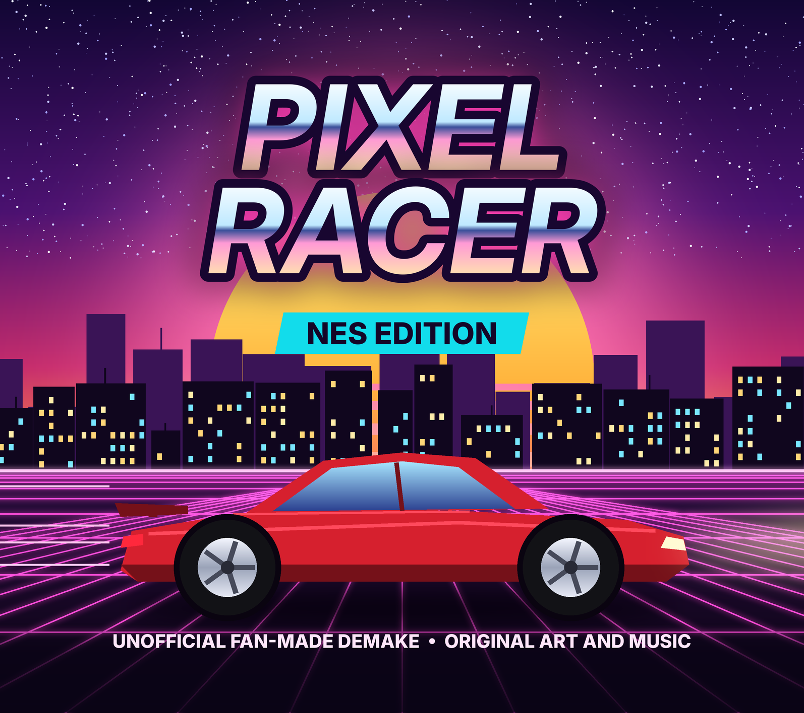</p>

Print-ready label art for a real cart is in `art/label/`. All of it is
original artwork. Both labels are 600 dpi, with 2 mm of bleed on every side:

| File | Use |
|---|---|
| `front.png` / `front.pdf` | Front label. The PDF has the exact physical size, for print shops |
| `end.png` / `end.pdf` | Top end label |
| `*_guides.png` | Proofs only. Green is the trim line, blue the 3 mm safe area. Don't print these |

Label areas differ between shells and reproduction cases. Measure yours, or
use your label stock's template, then regenerate at that trim size in mm
(width x height):

```
python3 tools/mklabel.py --front 63.5x56 --end 50x12 --bleed 2 --dpi 600
```

The logo and text stay inside the safe area at any size. Print on glossy or
matte vinyl (laminate it if you can), cut on the trim line, and put the
bleed edge to the edge of the label recess.

## How it works

* **Physics** (`src/physics.s`). Fixed-point 24-bit speed and position per
  car. It models:
  * a torque curve stretched to each car's redline;
  * turbo boost that ramps in with rpm and spools over time;
  * gearing, aero drag and rolling resistance;
  * a traction limit set by tires, suspension and drivetrain;
  * wheelspin, with separate wheel and car speeds;
  * clutch slip on launch, timed gear shifts and nitrous.

  `tools/gamedata.py` holds a Python reference model of the same maths, and
  `tests/test_physics.py` checks that the 6502 code matches it frame by frame
  for every car.
* **Rendering.** The HUD at the top doesn't scroll. A sprite-0 hit splits it
  from the city skyline, which scrolls at 1/4 speed for parallax. A timed
  second split starts the road, which scrolls at full speed. The start and
  finish lines are streamed into the nametables as columns. Race logic is
  budgeted to fit in one frame, so races run at a steady 60 fps.
* **Vblank budget.** The NMI uploads sprites, the palette, a VRAM update
  queue and (for the menus' 2x car previews) 32 bytes of tile data per
  frame. Tile streaming is skipped on frames that already upload the palette
  or a long queue, so all PPU writes finish inside vblank on real hardware.
  `tests/test_nmi.py` times the NMI on real game frames (including the
  514-cycle sprite DMA) and fails if any frame would overrun.
* **Sound** (`src/sound.s`). A 4-channel music player plays an original
  theme and jingles. The theme starts on the first frame of the boot splash
  and keeps playing through the title and the garage. After every race the
  garage rolls day, sunset or night at random. By day it plays "Midnight
  Garage" or "Neon Boulevard"; at sunset the roll-up door is open on a
  purple and red sky with the sun going down behind a black skyline, the
  walls glow warm, and one of the day themes plays; at night the door is
  open on a starry sky and a lit skyline, the walls go dark blue, and "After
  Hours" plays. Choosing a title
  option or a race blips an engine rev (a pulse growl that follows the race
  engine's rpm-to-pitch curve, plus an exhaust rumble) over the music. In races, an engine synthesizer drives pulse 1 and the
  triangle from your rpm and pulse 2 from the rival's. The noise channel
  handles exhaust rumble, tire squeal, nitrous hiss, blow-off valve and
  shift sounds.
* **Multiplication** uses quarter-square tables, so 16x16 multiplies take
  about 300 cycles.

## Tests

`make test` runs these suites:

* `tests/test_physics.py` runs the physics on a 6502 emulator (py65) and
  checks it against the Python model, frame by frame.
* `tests/test_nmi.py` checks that every NMI's PPU writes fit in vblank
  (menus, dealer browsing, a street race).
* `tests/test_password.py` checks the passwords: the reference encoder in
  `tools/password.py` round-trips, the ROM's passwords match it, both typed
  into a fresh console restore the game, and wrong passwords are refused.
* `tests/test_keyboard.py` runs the keyboard scan on py65 against a model of
  the Family BASIC keyboard: every letter types itself, DEL and RETURN work,
  a held key types once, the reads wait for the keyboard, and nothing
  plugged in (or an expansion pad) types nothing.
  It also checks the keyboard as controller 1: each key's button, several at
  once, no keyboard (or an expansion pad) pressing nothing, and the cost.
* `tests/test_tape.py` runs the data recorder on py65 against a model of the
  tape port: a save goes onto tape and back, through Mesen's way of
  recording, a flipped signal, a tape 10% fast or slow and timing wobble;
  a bad bit, a silent tape (B gives up) and a tape from another version
  are refused and leave the game as it was.
* `tests/test_boss_cars.py`: winning a boss's car, a full garage selling it,
  the locks, its sell price, crate part prizes passing it by, and boss cars
  in the garage password.
* `tests/test_rewards.py` runs the race rewards on py65: quick race XP by
  difficulty and region.
* `tests/test_cheats.py` runs the game with each Game Genie code applied
  and checks that the cheat works, and that the debug menu stays hidden
  without the code.
* `tests/test_game.py` plays the ROM in the cynes NES emulator. It covers new
  game, buying parts, state kept across a reset, a test run, beating the
  first ladder boss, foul starts, a street race with no dropped frames, the
  dealer and crates.

## Layout

```
src/        6502 source (main.s includes everything)
tools/      graphics (mkchr.py, art.py, mkmap.py), data (gamedata.py, mkdata.py), music (mkmusic.py)
cfg/        ld65 memory map
tests/      emulator test suites
docs/       screenshots
art/label/  cartridge label art (tools/mklabel.py)
release/    prebuilt ROM
```
